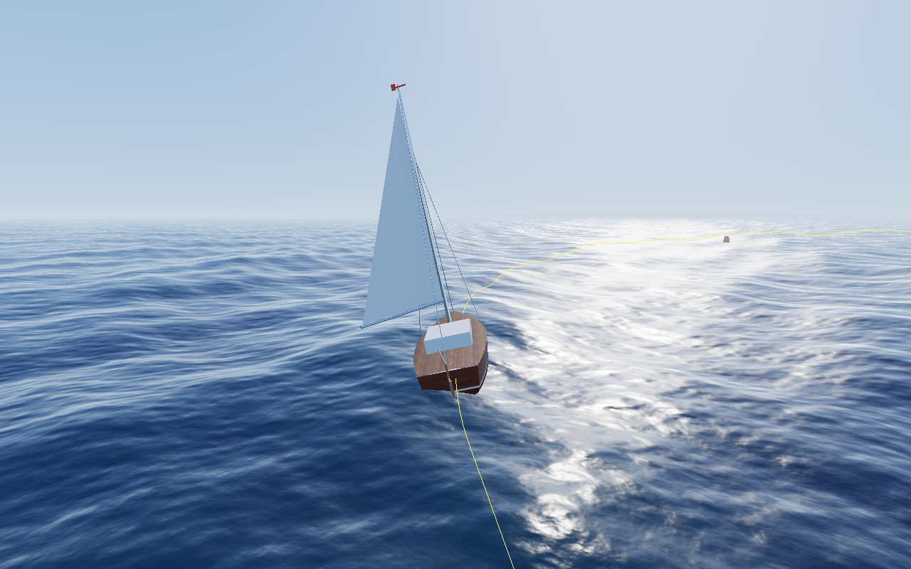

# Sailboat Tech Demo (CS4515 final project)

Real-time OpenGL 4.1 tech demo: a procedurally built sailboat races a Bézier buoy course on an endless
Gerstner ocean. One wind control drives the waves, sail, boom, heel and speed; a time-of-day slider
drives the procedural sky, environment map and lighting. Every feature can be toggled in the UI.



## Build and run

```bash
cmake -S . -B build -G Ninja -DCMAKE_BUILD_TYPE=Debug
ninja -C build
./build/Master_TechDemo
```

Keys: `1`–`4` cameras, `C` curve, `Space` pause, `P` screenshot. Orbit camera: drag + scroll.

B4 crest foam: in **Water**, enable **Crest foam (B4)** and adjust **Foam compression threshold**
(default 0.86; increasing it creates foam on less compressed crests). The wave vertex shader
uses the determinant of horizontal Gerstner displacement to identify crest compression, while
water's existing tileable ripple texture breaks up the foam in the fragment shader. `--set foam=0/1`
and `--set foamThreshold=0.86` support reproducible comparisons. No new C++ sources,
textures or render passes are needed; existing shader files are rebuilt automatically.

B3 minimap: enable **Show minimap** in the panel to display a movable, top-down ImGui map
with a bright boat-heading marker. **Map resolution (px)** adjusts size (128–512), and
**Heading up** rotates the map so the boat points toward the top. The `--set` equivalents are
`minimap=0/1`, `minimapSize=256` and `minimapFollowsHeading=0/1`. Scripted
`--capture` screenshots include a small map overlay when `minimap=1`, because ImGui draws later.
Re-run CMake after updating: B3 adds `src/minimap.cpp` and `shaders/minimap_overlay_frag.glsl`.

Scripted screenshots (no window):
`./build/Master_TechDemo --capture out.png --frames 400 --camera orbit --time 17.6 --set shadows=0`

## Documentation

- [docs/ARCHITECTURE.md](docs/ARCHITECTURE.md) — what is built: feature coverage, UML class diagrams,
  scene hierarchy, interaction (sequence) diagrams, subsystem details.
- [docs/TODO.md](docs/TODO.md) — remaining features with step-by-step guides, split into two parallel
  tracks, git workflow, report/video checklist.
- [docs/sailboat_plan.md](docs/sailboat_plan.md) — concept, feature owners, report notes and references.
- [docs/TRACK_B_IMPLEMENTATION_NOTES.md](docs/TRACK_B_IMPLEMENTATION_NOTES.md) — Track B feature log, design decisions, validation and report drafts.

## Hand-in reminder

Do not include `build/` in the submission (−0.5). The report needs ≥ 2 screenshots per feature and a
first page with each member's share per feature.
