# Sailboat Tech Demo: architecture and what is built

State as of 2026-11-03. This describes the code that exists now; the work still to do is in
[TODO.md](TODO.md), the original plan in [sailboat_plan.md](sailboat_plan.md).

A small wooden sailboat races a buoy course on an endless ocean. One wind control (direction and
strength) drives the waves, the sail, the boom, the wind vane, the heel and the boat speed. A
time-of-day slider moves the sun, recolours the procedural sky, and with it everything that
reflects the sky. Every feature can be switched on and off from the ImGui panel.

| Chase camera | Orbit camera, shadows + shadow-map view |
|---|---|
| 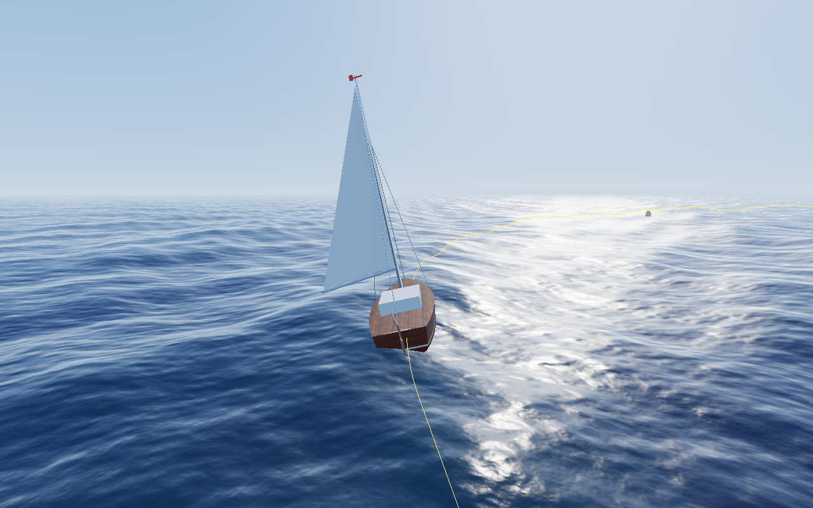 | 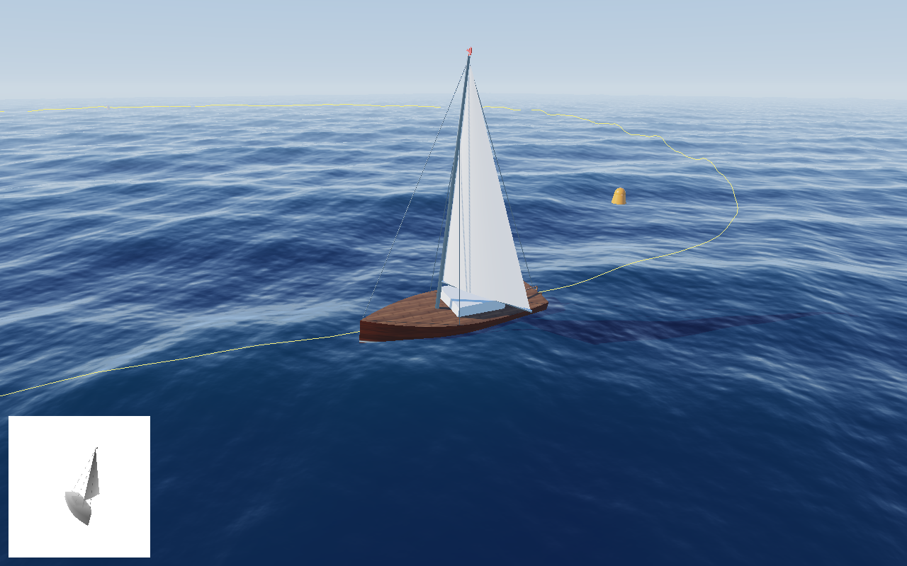 |
| **Deck camera (node in the hierarchy)** | **Top view: Bézier course + boat marker** |
| 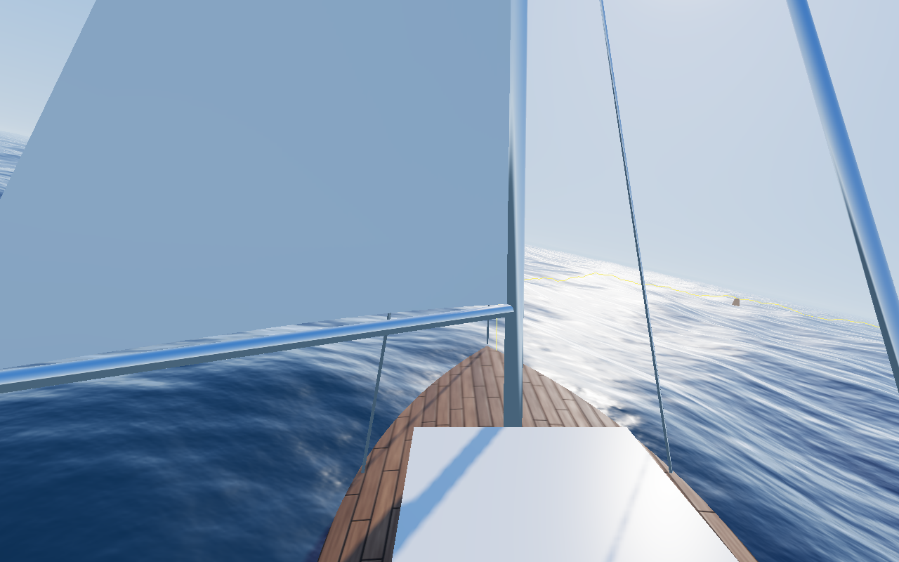 | 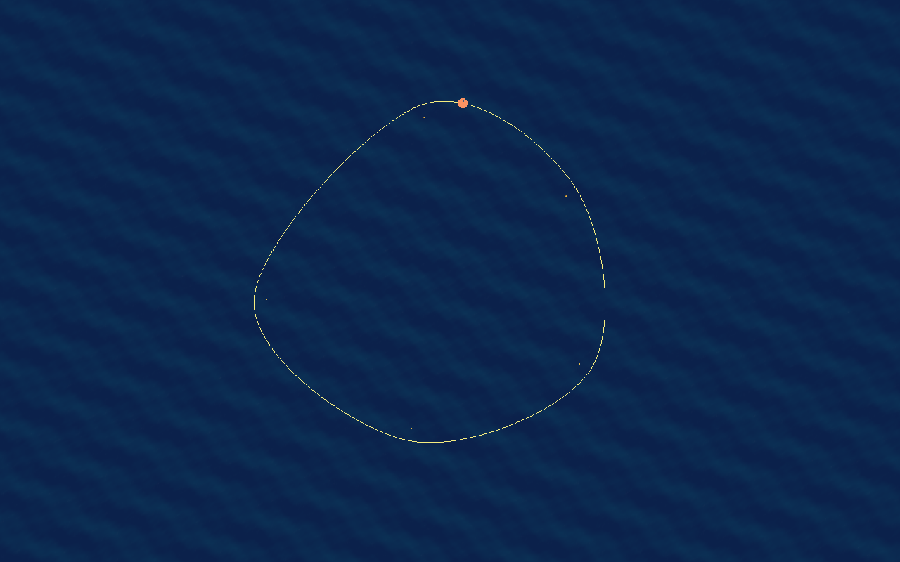 |

---

## 1. Running it

```bash
cmake -S . -B build -G Ninja -DCMAKE_BUILD_TYPE=Debug   # Debug enables the OpenGL debug callback
ninja -C build && ./build/Master_TechDemo
```

| Input | Action |
|---|---|
| `1` `2` `3` `4` | Chase / deck / top / orbit camera |
| left drag, scroll | Rotate / zoom (orbit camera only) |
| `C` | Toggle the Bézier curve |
| `Space` | Pause the boat |
| `P` | Screenshot of the scene (without UI) to `screenshots/shot_<time>.png` |

Reproducible screenshots without a window (fixed 1/60 s time step):

```bash
./build/Master_TechDemo --capture out.png --frames 400 --camera deck --time 17.6 --wind 330 --set shadows=0
```

`--set name=value` accepts every field listed in `applySetting()` in
[application.cpp](../src/application.cpp) (names are the `FeatureToggles` field names).

---

## 2. Feature coverage

### Minimal requirements

| Requirement | What we did | Main code | UI toggle |
|---|---|---|---|
| Multiple viewpoints | Chase, deck (camera is a node in the boat hierarchy), orthographic top view with boat marker, free orbit | [camera.cpp](../src/camera.cpp) | Viewpoint → Camera, keys 1–4 |
| Advanced shading | Cook-Torrance: GGX distribution, Smith-Schlick geometry, Schlick Fresnel, metallic/roughness; Blinn-Phong for comparison | [pbr_frag.glsl](../shaders/pbr_frag.glsl) | Shading → PBR |
| Material textures | Generated albedo, roughness and normal maps: lapstrake mahogany + antifouling hull, teak deck | [procedural_texture.cpp](../src/procedural_texture.cpp) | Shading → Material textures |
| Normal mapping | Per-vertex tangents (Lengyel) in an extra VBO, TBN in the shader; scrolling ripple normals on the water | [mesh.cpp](../src/mesh.cpp), [pbr_frag.glsl](../shaders/pbr_frag.glsl), [water_frag.glsl](../shaders/water_frag.glsl) | Shading → Normal mapping, Water → Detail normal map |
| Environment mapping | Procedural sky rendered into a cubemap; skybox, Fresnel reflections on the water, image-based light on the boat | [sky.cpp](../src/sky.cpp), [sky_frag.glsl](../shaders/sky_frag.glsl) | Shading → Environment map / Skybox |
| Smooth paths (≥ 3 cubic Béziers) | Closed C1 course of 5 cubic segments; curve and control polygon drawn optionally | [bezier.cpp](../src/bezier.cpp), [course.cpp](../src/course.cpp) | Boat and course → Show Bezier curve / control polygon |
| Hierarchical transformations | Boat → hull → mast → boom → sail, rudder → tiller, wind vane, deck camera; built and animated in code | [boat.cpp](../src/boat.cpp), [scene_node.cpp](../src/scene_node.cpp) | (always on; wind/pause change it) |

### Extras done

| Extra | What we did | UI toggle |
|---|---|---|
| Constant speed along a Bézier | Arc-length table + binary search; can switch to naive parameter speed to compare | Boat and course → Constant speed |
| Procedural water | Sum of up to 8 Gerstner waves in the vertex shader on an endless camera-following grid | Water → Gerstner waves, Wave count, Wave height, Wireframe |
| Buoyancy (own feature) | The CPU evaluates the same wave sum at 4 hull points → heave, pitch, roll; buoys bob too | Boat and course → Buoyancy |
| Wind-driven rig (own feature) | Boom trims to the wind with a rate limit (visible tacks/gybes), sail billows to leeward, heel, vane, speed polar | Wind → From, Strength; Boat → Wind affects speed |
| Changing lighting (day-night) | Sun path, sunset colours, moonlight, stars; sky cubemap re-rendered when the sun moves | Sky and light → Time of day, Day-night cycle |
| Shadows (one light) | Sun/moon shadow map, PCF, slope-scaled bias, texel snapping, edge fade, debug view | Shadows → … |
| HDR + tone mapping | RGBA16F scene target, ACES filmic curve, exposure (prepares bloom) | Sky and light → Exposure |

---

## 3. Module map

The simulation side never calls OpenGL in its update code; the renderer never knows it is drawing a boat.
They meet in plain data: `RenderLists` (`DrawItem`s, `LineBatch`es, extra passes), `CameraView`,
`Lighting`, `SpotLight` and `FrameContext`. Section 7.12 lists the extension points for new features.

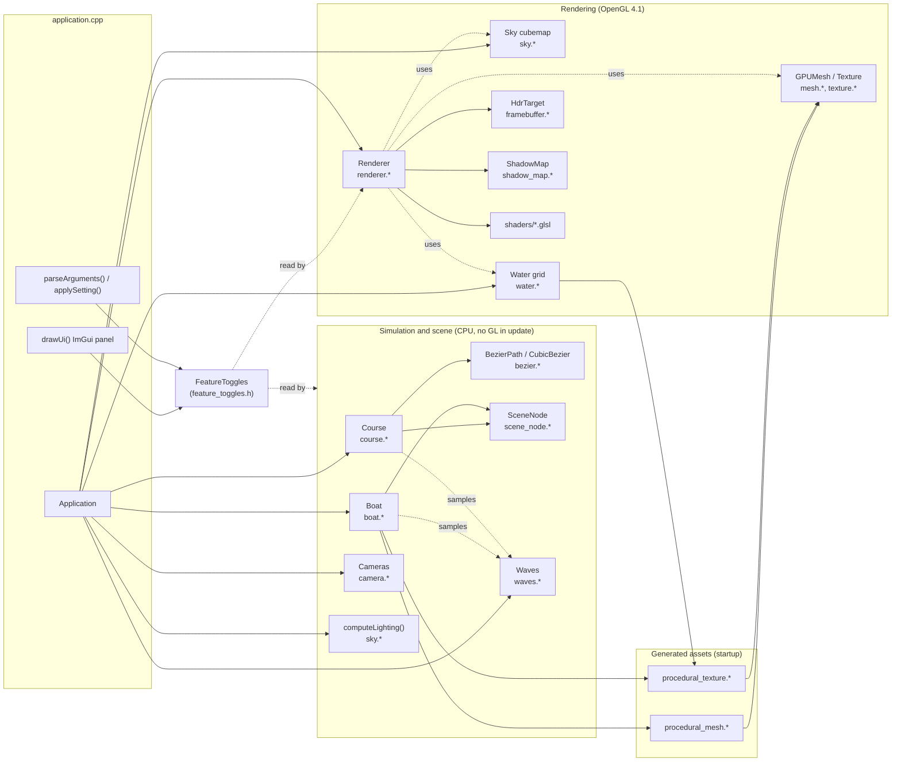

### Files

| File | Responsibility |
|---|---|
| `application.cpp` | `Application` (owns everything, main loop, UI panel, input, screenshots), command line, `main` |
| `feature_toggles.h` | One struct with every UI flag and parameter |
| `camera.*` | `Cameras`: chase / deck / top / orbit → `CameraView` |
| `bezier.*` | `CubicBezier`, `BezierPath` (closed C1 loop, arc-length table) |
| `course.*` | Anchor points, the path, buoys, debug lines for curve and control polygon |
| `boat.*` | Boat meshes, materials, node tree, per-frame motion and animation |
| `scene_node.*` | Transformation hierarchy: `world = parent.world · rest · anim` |
| `waves.*` | Gerstner wave set, CPU displacement/normal/height query |
| `water.*` | Camera-following grid mesh + ripple normal texture |
| `sky.*` | `computeLighting(hours)`, procedural sky → cubemap |
| `renderer.*` | All passes: shadow → opaque → water → lines → skybox → tonemap → shadow-map view |
| `framebuffer.*` | `HdrTarget` (RGBA16F colour + depth) |
| `shadow_map.*` | `ShadowMap` (depth texture with compare mode), `directionalLightMatrix()` |
| `procedural_mesh.*` | Hull, deck, sail, box, cylinder, sphere, helpers |
| `procedural_texture.*` | Plank/strake/ripple textures (pure CPU) |
| `mesh.*`, `texture.*` | Starter code, extended: tangent VBO, raw-pixel textures, sRGB, fixed move assignment |
| `uniforms.h` | Silent uniform setters for the bound program |
| `draw_item.h` | `PBRMaterial`, `DrawItem`, `LineBatch`, `ExtraPass`, `RenderLists`: what the scene hands to the renderer |
| `lights.h` | `SpotLight`: second light, filled by the scene, read by the renderer |

---

## 4. Class diagrams (UML)

### 4.1 Simulation and scene

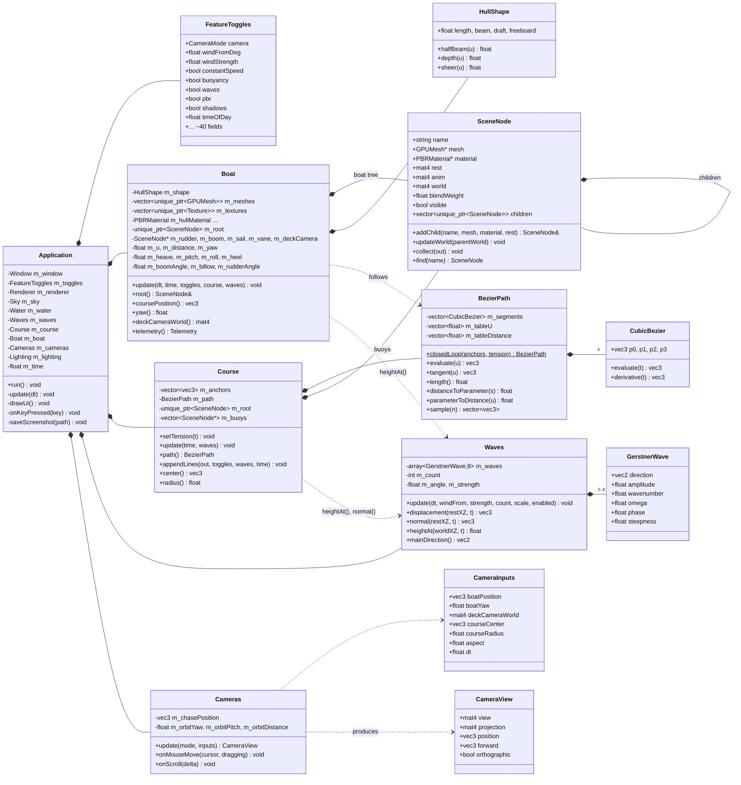

### 4.2 Rendering

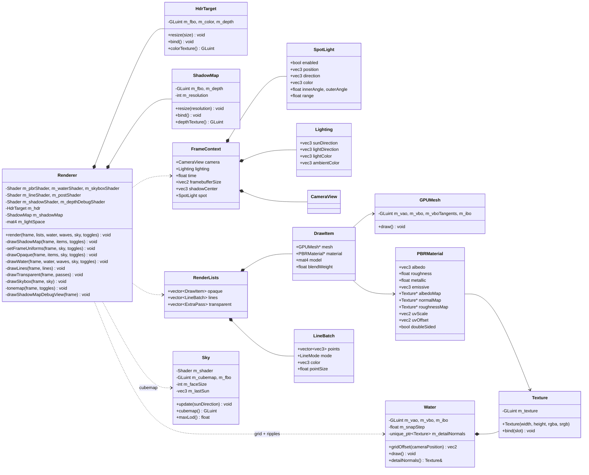

---

## 5. The boat hierarchy

`world = parent.world · rest · anim`. **rest** is set once in the `Boat` constructor (layout),
**anim** is rewritten every frame in `Boat::update` (motion). Boat frame: +z forward (bow),
+y up, +x to port, origin on the waterline amidships, metres.

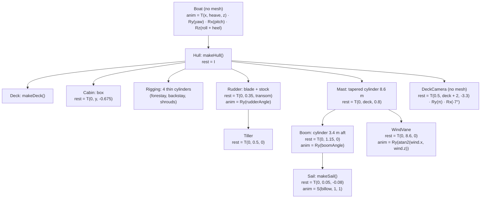

Why the parts move the way they do (all in [boat.cpp](../src/boat.cpp) `Boat::update`):

| Node | Driven by | Rule |
|---|---|---|
| Boat | course + waves + wind | Position `B(u)` on the path; yaw `atan2(B'.x, B'.z)`; heave/pitch/roll from 4 wave samples, smoothed (τ ≈ 0.3 s); heel = 22° · strength · (side component of the wind) |
| Rudder (→ tiller) | turn rate | `-3 · yawRate`, clamped to ±0.6 rad, smoothed; the tiller swings opposite to the blade because it is rigidly attached on the other side of the pivot |
| Boom (→ sail) | apparent wind angle α | target `side · clamp(0.55α − 0.1, 0.05, 1.45)`, moved at most 1.2 rad/s, so tacks and gybes show the boom crossing |
| Sail | wind strength, boom side | non-uniform scale in boom-local x: sign = leeward side, size = fullness; never below 0.05 (singular normal matrix) |
| WindVane | wind in the boat frame | points into the wind |
| DeckCamera | (inherits everything) | view matrix = `inverse(world)` |

The sail scale is the reason the PBR vertex shader gets a real inverse-transpose normal matrix.

---

## 6. Interaction diagrams

### 6.1 Startup

Members are constructed in declaration order; the `Window` must come first because it creates the
OpenGL context everything else uploads to.

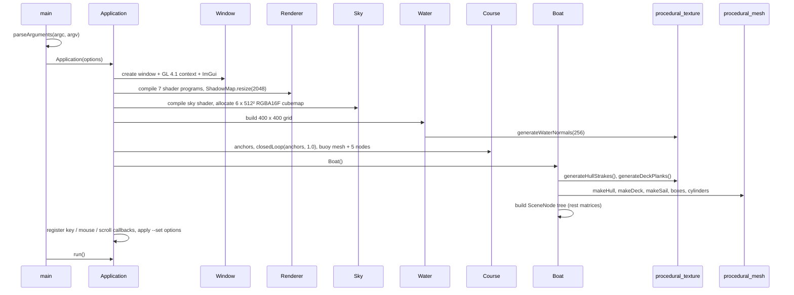

### 6.2 One frame

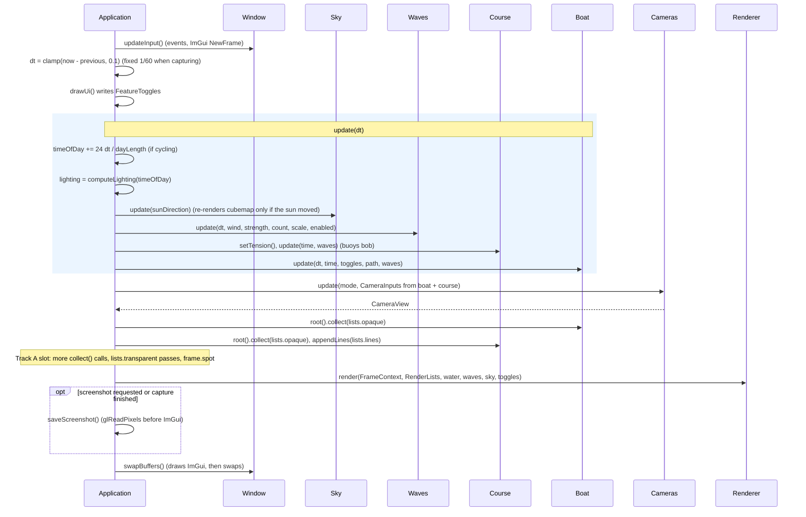

### 6.3 Inside `Boat::update`

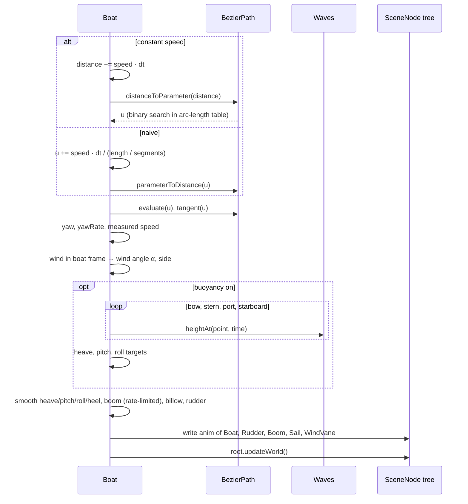

### 6.4 Inside `Renderer::render`

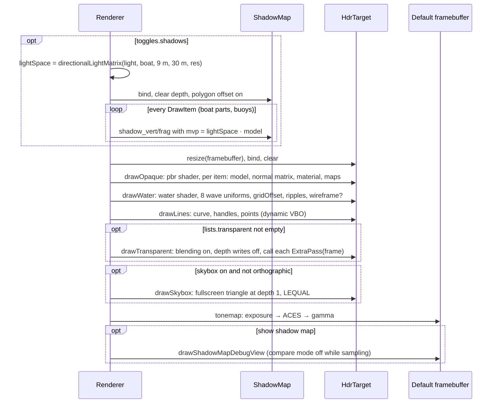

### 6.5 Wind and waves: one source, two consumers

The wave set is computed once per frame on the CPU and used twice: uploaded to the GPU to draw the
water, and evaluated on the CPU so the boat and buoys float on exactly the drawn surface.

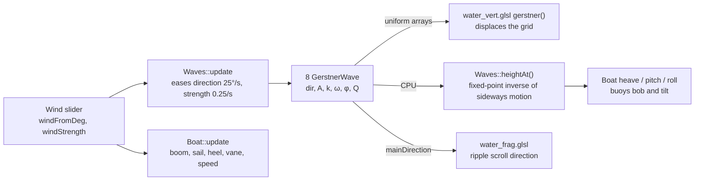

### 6.6 Camera modes

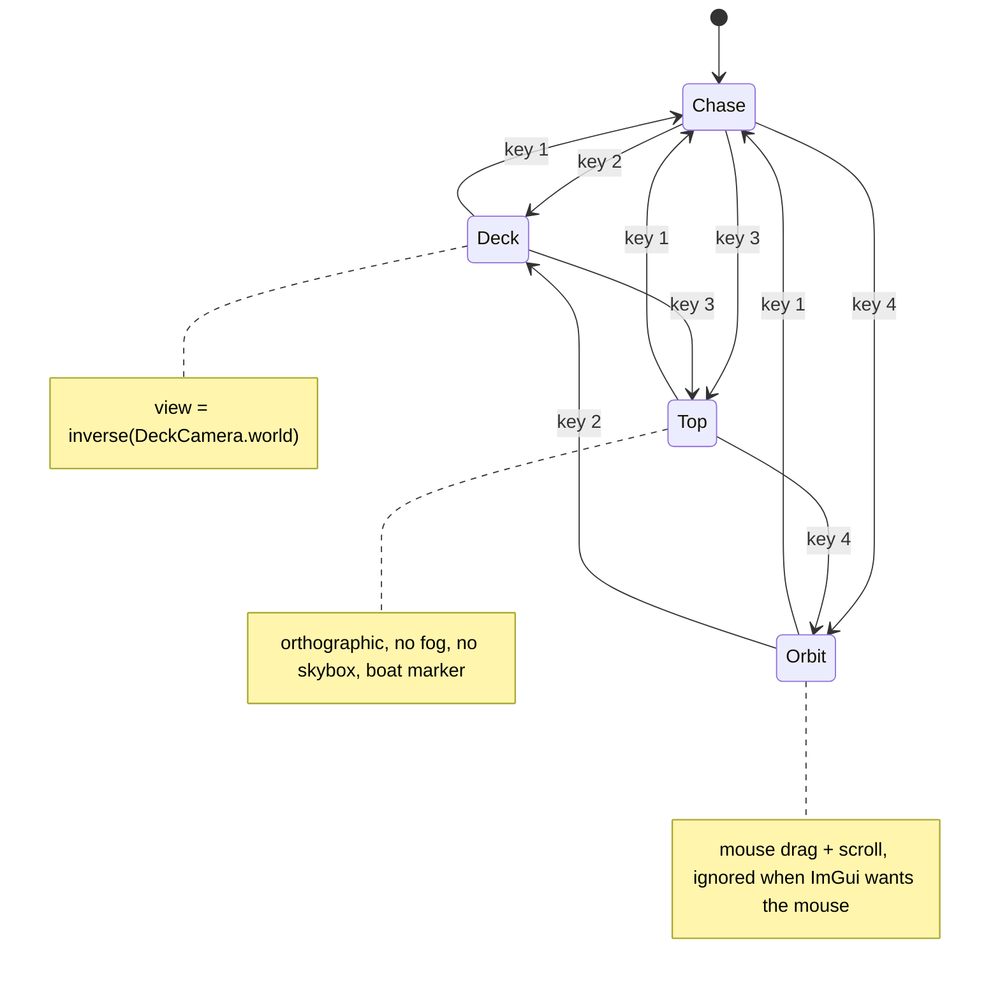

### 6.7 Shadow lookup (per fragment)

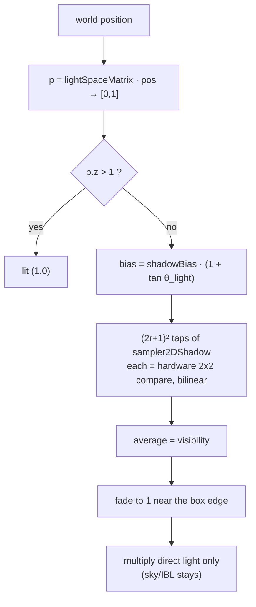

---

## 7. Subsystems in detail

### 7.1 Toggles, UI and command line

- `FeatureToggles` ([feature_toggles.h](../src/feature_toggles.h)) is the single source of truth. The UI
  (`Application::drawUi`) writes it; everything else reads it. Keys write it too.
- `applySetting()` maps names to fields for `--set`. When you add a toggle, add it there as well so it
  can be scripted for report screenshots.

### 7.2 Course and Bézier path

- Five anchors around the origin; a buoy 9 m inside each turn.
- `BezierPath::closedLoop`: segment *i* from `P_i` to `P_{i+1}` with inner control points
  `P_i + τ(P_{i+1} − P_{i−1})/6` and `P_{i+1} − τ(P_{i+2} − P_i)/6` (Catmull-Rom tangents). Both
  neighbours of an anchor share the same tangent → C1. τ is the "Curve tension" slider.
- Arc length: 200 samples per segment, cumulative polyline length. `distanceToParameter` =
  `lower_bound` + linear interpolation. Constant speed: advance distance; naive: advance `u`.
- Debug lines are draped on the waves (`heightAt + 0.4`) so they stay visible.

### 7.3 Waves (Gerstner)

- Rest point `p`, wave *i*: `θ = k (D·p) − ωt + φ`, displacement
  `(Q A Dx cos θ, A sin θ, Q A Dz cos θ)`, deep-water dispersion `ω = √(g k)`.
- Fixed wavelengths 33, 21, 13.5, 8.6, 5.7, 3.9, 2.7, 1.9 m, spread ±70° around the wind.
  Amplitude `0.017 · λ · strength · scale`.
- Steepness `Q_i = 0.65 / (k_i A_ref,i N)` with the full-wind amplitude → Σ Q k A ≤ 0.65 at scale 1
  (no looping crests); the "Wave height" slider up to 2 deliberately allows loops for a report figure.
- Only direction and amplitude follow the wind; changing `k` would make `ωt` jump.
- `heightAt(x)`: Gerstner moves points sideways, so iterate `rest = x − horizontal(rest)` 4 times.

### 7.4 Water grid

- 400 × 400 vertices, half-size 450 m. Spacing grows quadratically: ≈ 0.34 m at the centre, ≈ 4 m at
  the edge. Re-centred under the camera every frame, snapped to the finest spacing → no swimming.
- Fog (`1 − exp(−(d/260)²)`) to the sky's horizon colour hides the edge.
- Fragment shading: analytic Gerstner normal + two scrolling ripple-normal layers (whiteout blend,
  faded with distance) → Schlick Fresnel (F0 = 0.02) between a body colour and the sky reflection,
  plus a GGX sun glint in HDR.

### 7.5 Sky, environment map and lighting

- `computeLighting(hours)`: sun on a tilted arc (sunrise 6:00, sunset 18:00), warm colour near the
  horizon, moonlight (dim, blue, opposite direction) below it.
- `Sky::update` renders `sky_frag.glsl` into the 6 faces of a 512² RGBA16F cubemap (face basis vectors
  follow the GL spec cubemap table) and builds mipmaps — only when the sun moved.
- The mips double as a cheap blur: the PBR shader picks `lod = roughness · (maxLod − 1)` for
  reflections and the blurriest mip as irradiance (split-sum idea, Karis' analytic EnvBRDF instead
  of a LUT). Seamless cube filtering is enabled.

### 7.6 Procedural geometry ([procedural_mesh.cpp](../src/procedural_mesh.cpp))

- **Hull**: 48 stations along the length; each section is a superellipse quadrant (n = 2.4) from keel
  to waterline plus a flared topside to the deck edge. Separate port/starboard grids (crisp keel,
  consistent tangent handedness); the port side has flipped winding. Transom = strips per section
  level. UV u = along the length, v = girth: 0 keel, 0.5 waterline, 1 deck edge — the texture uses
  that split for antifouling vs varnish.
- **Deck**: grid across the beam with camber, UVs in metres (planks along the boat).
- **Sail**: triangle grid, camber profile deepest at ~40 % chord, bulging to +x; the node scale flips it.
- Primitives: box (UVs in metres per face), cylinder/cone with caps, cylinder between two points,
  UV sphere. `computeSmoothNormals` = area-weighted face normals.

### 7.7 Procedural textures ([procedural_texture.cpp](../src/procedural_texture.cpp))

- Tileable value noise / fBm (lattice wraps with the period, so every texture tiles).
- Deck 512²: 8 planks per metre, caulking seams, butt joints, grain, per-plank tint; roughness;
  height → normals.
- Hull 1024 × 512: lapstrake height profile (sawtooth per strake) → strong normal-map lines; red
  antifouling below v = 0.5, cream boot stripe, varnished mahogany above.
- Water ripples 256²: sum of sines with integer wave vectors (tile exactly) + fBm.
- Colour maps are uploaded as sRGB (`GL_SRGB8_ALPHA8`) so the shader receives linear values.

### 7.8 Renderer, targets and texture units

| Pass | Target | Shader(s) | Notes |
|---|---|---|---|
| Shadow | `ShadowMap` (depth 24, 2048²) | `shadow_vert/frag` (starter) | polygon offset 1.5/2.0, no culling |
| Opaque | `HdrTarget` RGBA16F | `pbr_vert/frag` | no back-face culling (sail) |
| Water | `HdrTarget` | `water_vert/frag` | optional `glPolygonMode(GL_LINE)` |
| Lines | `HdrTarget` | `line_vert/frag` | round points via `gl_PointCoord` |
| Extra transparent passes | `HdrTarget` | the feature's own | `RenderLists::transparent`; blending on, depth writes off |
| Skybox | `HdrTarget` | `skybox_vert/frag` | depth 1, `GL_LEQUAL`, skipped in top view |
| Tonemap | default framebuffer | `fullscreen_vert` + `post_frag` | exposure → ACES → gamma 2.2 |
| Shadow-map view | default framebuffer corner | `fullscreen_vert` + `depth_debug_frag` | compare mode off while drawing |
| Sky cubemap | cubemap faces (on change) | `fullscreen_vert` + `sky_frag` | in `Sky::update` |

| Unit | PBR shader | Water shader |
|---|---|---|
| 0 | albedo map | ripple normal map |
| 1 | normal map | – |
| 2 | roughness map | – |
| 3 | environment cubemap | environment cubemap |
| 4 | shadow map (`sampler2DShadow`) | shadow map |

Uniforms are set with `uniform::set(name, value)` ([uniforms.h](../src/uniforms.h)), which stays silent for
uniforms the driver optimised away.

### 7.9 PBR shader ([pbr_frag.glsl](../shaders/pbr_frag.glsl))

`(k_D · albedo/π + D·G·F / (4 N·V N·L)) · lightColor · N·L · visibility + IBL + emissive`, then fog.
D = GGX (α = roughness²), G = Smith with Schlick-GGX (k = (r+1)²/8), F = Schlick. IBL as in 7.5.
Normal mapping builds a Gram-Schmidt TBN from the interpolated tangent (w = handedness). Double-sided
materials flip N towards the viewer.

### 7.10 Shadows ([shadow_map.cpp](../src/shadow_map.cpp))

- Orthographic box in light space around the boat (half-size 9 m, ±30 m deep), centre snapped to
  whole texels (no shimmering). Light = sun by day, moon at night.
- Depth texture with `GL_COMPARE_REF_TO_TEXTURE` + `GL_LINEAR` → each lookup is a 2×2 PCF;
  the shader averages a (2r+1)² grid. Border = 1 (lit), fade near the edge.
- Bias: `glPolygonOffset` in the depth pass + slope-scaled bias in the lookup.
- Water receives but does not cast.

### 7.11 Cameras ([camera.cpp](../src/camera.cpp))

- Chase: 17 m behind, 5.5 m up, heading only, exponential smoothing (frame-rate independent).
- Deck: node in the hierarchy, `view = inverse(world)` → rocks with the boat.
- Top: `glm::ortho` around the course, 500 m up; the renderer disables fog and the skybox.
- Orbit: yaw/pitch/distance around the boat.
- Perspective: 55° vertical FOV, near 0.2 m, far 2000 m.

### 7.12 Extension points (how a new feature plugs in)

Added so the two of us can build features in parallel without editing each other's files.

| You want to… | Use | Where |
|---|---|---|
| Draw new opaque meshes (lit, shadowed) | Build a `SceneNode` tree, `collect()` it into `lists.opaque` | Track A slot in `Application::run` |
| Draw something blended (particles, beams) | `lists.transparent.push_back([this](const FrameContext& f) { … })` — your own shader/VAO; state contract in `renderer.h` | Track A slot in `Application::run` |
| Add a second light | Fill `frame.spot` (`SpotLight`, [lights.h](../src/lights.h)); the renderer reads it | Track A slot in `Application::run` |
| Deform a mesh with blend shapes | Upload `target − base` positions/normals as vertex attributes 4 and 5, set `SceneNode::blendWeight`. `pbr_vert.glsl` and `shadow_vert.glsl` already apply `blendWeight · delta`; meshes without those attributes read (0, 0, 0) | `mesh.cpp` (GPUMesh upload), your scene code |
| Animate a texture (flipbook) | Change `PBRMaterial::uvScale/uvOffset` each frame from the simulation time; the shader uses `uv · uvScale + uvOffset` | your scene code |
| Add a toggle | Field in `FeatureToggles` (your track's section), entry in `applySetting()` (your track's comment), UI method + one call in `drawUi()` (your track's slot) | `feature_toggles.h`, `application.cpp` |
| Add a source file | One line in your track's section of `add_executable` | `CMakeLists.txt` |

Every shared file has `// ---- Track A …` and `// ---- Track B …` comment slots, so your additions land
in different places and git merges them without conflicts.

---

## 8. Conventions and gotchas

- Units are metres, seconds, radians (degrees only in the UI). World: +y up. Wind angle = direction
  the wind comes **from**, 0 = from +z.
- Every animation uses real `dt` (clamped to 0.1 s), never frame counts.
- OpenGL 4.1 core (macOS limit): no compute shaders, no `layout(binding = …)`, no `#include` in GLSL.
  `fog`, `lightVisibility` are duplicated in `pbr_frag.glsl` and `water_frag.glsl` — keep them in sync.
  `gerstner()` in `water_vert.glsl` must match `Waves::displacement/normal`.
- New `.cpp` → add it to `add_executable` in `CMakeLists.txt`. New shader → re-run CMake (shaders are
  globbed at configure time).
- Don't commit `build/` (−0.5 at hand-in); `.gitignore` covers it.

## 9. Known limitations

- Only one shadowed light (the brief's extra asks for multiple).
- The sail's back side gets no direct light (no translucency).
- Stars are cubemap cells and look slightly square close up.
- The water does not self-shadow; no foam yet.
- Only tested on Linux (Mesa, AMD 780M) in a Debug build; check a Release build and the other
  teammate's OS early.
