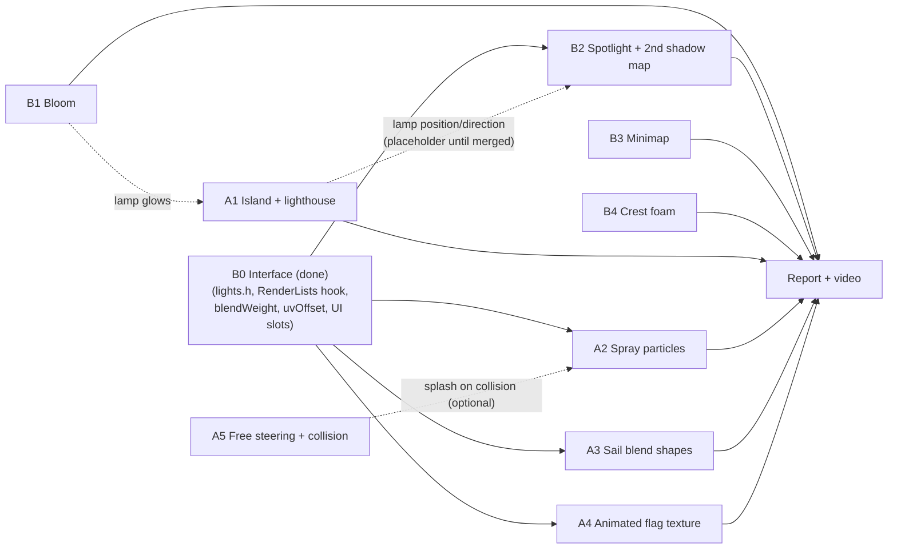

# What is left: features, guides and how to split them

What exists is described in [ARCHITECTURE.md](ARCHITECTURE.md). This file lists everything still to
build, split into two tracks that can be worked on **at the same time** with few merge conflicts.
Every guide says which files you create (yours alone) and which shared files you touch (keep those
edits small and announce them).

All 7 minimal requirements are done. Everything below is extras, polish and hand-in.

---

## 0. How we split the work

| | Track A: world and simulation | Track B: render pipeline |
|---|---|---|
| Mindset | New things in the scene, CPU logic, their own meshes/shaders | New passes, post-processing, lighting models |
| Features | A1 Island + lighthouse (**done**), A2 Spray particles, A3 Sail blend shapes, A4 Animated flag texture, A5 Free steering + buoy collision (optional) | B1 Bloom (**done**), B2 Spotlight + second shadow map (**done; targeted self-occlusion fix tested**), B3 Minimap (**implemented in B3 branch; visual review pending**), B4 Crest foam (B0 interface: **done**) |
| Owns files | `island.*`, `particles.*`, `flag.*`, `boat.*`, `course.*`, `procedural_*`, `waves.*`, `particle_*.glsl`, `terrain_*.glsl` | `renderer.*`, `bloom.*`, `minimap.*`, `lights.h`, `shadow_map.*`, `framebuffer.*`, `sky.*`, `pbr_*.glsl`, `water_*.glsl`, `post_frag.glsl`, `bloom_*.glsl` |
| Rough hours | ≈ 12–14 | ≈ 11–13 |

Each feature has **one owner** (that's what the report's percentage page needs). The other person
reviews the merge request — that is also the best preparation for the oral questions, since you can
both be asked about anything in the demo.

### Shared files (hotspots) and the rule for each

| File | Who touches it | Rule |
|---|---|---|
| `src/feature_toggles.h` | everyone | Add your fields under your track's `// ---- Track A/B features` comment at the end of the struct |
| `src/application.cpp` | everyone | Use the marked `// ---- Track A …` / `// ---- Track B …` slots: UI method + one call in `drawUi()`, `applySetting()` entries, members, `update()`, render-list building |
| `src/renderer.cpp` | B only | A never edits it: A's drawing goes through `lists.transparent` / `lists.opaque` (see ARCHITECTURE.md §7.12) |
| `shaders/pbr_*.glsl`, `water_*.glsl` | B only | Blend shapes and UV offsets are already wired in. Keep `lightVisibility`/`applyFog` copies identical in both shaders |
| `src/draw_item.h`, `src/lights.h` | both, rarely | Additive changes only (new fields with defaults) |
| `CMakeLists.txt` | both | One line per new `.cpp` in your track's section; re-run CMake after adding a shader |

### Dependency graph



B0 is done, so both tracks can start right away; B2 uses a placeholder spotlight until A1 lands.

### Suggested timeline (T = when you both start)

| Time | Track A | Track B |
|---|---|---|
| T+0 – T+1 | Read ARCHITECTURE.md (§7.12 extension points), run the demo, take baseline screenshots | same, then start B1 |
| T+1 – T+5 | A1 Island + lighthouse | B1 Bloom |
| T+5 – T+8 | A2 Spray particles | B2 Spotlight + shadows (placeholder lamp, then A1's lamp) |
| T+8 – T+10 | A3 Sail blend shapes | B4 Crest foam |
| T+10 – T+12 | A4 Animated flag | B3 Minimap |
| T+12 – T+14 | A5 (only if ahead) / bug fixes | Release build check, performance |
| **Freeze** | **No new features after this point** | |
| last ~10 h | Screenshots, report sections for your features, video script | same |

Sleep is part of the 36 hours; cut from the bottom of each track, not from the report.

---

## 1. Git workflow

```bash
git clone https://github.com/groundbeeflover/sailboat-tech-demo.git
cd sailboat-tech-demo
cmake -S . -B build -G Ninja -DCMAKE_BUILD_TYPE=Debug && ninja -C build
```

- One branch per feature: `git switch -c feature/bloom`. Commit small and often.
- Before pushing: `git fetch && git rebase origin/main`, rebuild, run once, then push and open a merge
  (pull) request on GitHub. The other person reviews and merges. Delete the branch after merging.
- Conflicts will almost always be in `application.cpp` (UI blocks), `feature_toggles.h` and
  `CMakeLists.txt`: keep **both** sides, they are additive.
- Never commit `build/` (−0.5 at hand-in). `.gitignore` covers it; check `git status` before committing.
- Commit message style: `Bloom: separable Gaussian blur on the bright pass`.

### Definition of done (every feature)

1. Toggle in the UI (and its name in `applySetting()` so `--set name=0/1` works).
2. Visually obvious in at least one camera — show it, don't just compute it.
3. Two or more screenshots for the report: make on/off pairs with `--capture ... --set <toggle>=0/1`.
4. Commented code (why, not what), no new compiler warnings.
5. A paragraph for the report: what, how, *why this method over the alternatives*, references.
6. Owner + percentage noted in the table in [sailboat_plan.md](sailboat_plan.md).

---

## 2. Track B: render pipeline

### B0. Interface (done)

Merged before the split so that nobody has to edit someone else's files. What it added:

1. **`src/lights.h`**: `SpotLight { enabled, position, direction, color, innerAngle, outerAngle, range }`,
   and `FrameContext::spot` (disabled by default). Track A fills it, Track B shades with it.
2. **`RenderLists`** (`draw_item.h`): `Renderer::render(frame, lists, …)` takes `lists.opaque`,
   `lists.lines` and `lists.transparent`. Each `ExtraPass` in `transparent` is called after the lines
   and before the skybox, with the HDR target bound, depth test on, depth writes off and
   `glBlendFunc(GL_SRC_ALPHA, GL_ONE_MINUS_SRC_ALPHA)`; the renderer restores state afterwards
   (full contract in `renderer.h`).
3. **Blend shapes, shader side**: `SceneNode::blendWeight` → `DrawItem::blendWeight` → uniform.
   `pbr_vert.glsl` and `shadow_vert.glsl` add `blendWeight · delta` from vertex attributes 4
   (position) and 5 (normal). Meshes without those attributes are unaffected (tested).
4. **Animated textures**: `PBRMaterial::uvOffset`; the shader samples at `uv · uvScale + uvOffset`.
5. **UI and slots**: `drawUi()` is split into one method per section, and every shared file has
   `// ---- Track A …` / `// ---- Track B …` comment slots (toggles, `applySetting()`, members,
   `update()`, render lists, `CMakeLists.txt`).

The rendered output is byte-identical to before B0 (checked with captures).

### B1. Bloom (~2.5 h)

**Implementation:** done (2026-11-04). User confirmed A1+B1 work together on their workstation. See [Track B implementation notes](TRACK_B_IMPLEMENTATION_NOTES.md) for exact changes, algorithms and test results; report screenshots are still to be collected.

**Goal:** bright HDR parts (sun glints, sun disk, later the lighthouse lamp) bleed light into their
surroundings. The scene is already rendered to an RGBA16F target, so values above 1 survive.

**Method (recommended):** threshold → separable Gaussian blur, ping-pong at half resolution:
1. `BloomPass` class (`bloom.h/.cpp`) owning two half-resolution RGBA16F textures + FBOs (reuse the
   pattern of `HdrTarget`).
2. **Bright pass** (`bloom_bright_frag.glsl`): sample the HDR colour, keep what is above a threshold
   with a soft knee:
   ```glsl
   float brightness = max(color.r, max(color.g, color.b));
   float soft = clamp(brightness - threshold + knee, 0.0, 2.0 * knee);
   soft = soft * soft / (4.0 * knee + 1e-4);
   float contribution = max(soft, brightness - threshold) / max(brightness, 1e-4);
   out = color * contribution;
   ```
3. **Blur** (`bloom_blur_frag.glsl`): 9-tap Gaussian with `uniform vec2 direction` (1/width, 0) then
   (0, 1/height); repeat N times (UI: iterations 1–6). Use the linear-sampling trick (5 fetches for
   9 taps) if you want to mention an optimisation.
4. **Composite** in `post_frag.glsl`, *before* exposure/tone mapping: `hdr += bloomIntensity * bloom`.
5. Debug view toggle: show the bloom texture instead of the scene (good report figure).

**Touch points:** `renderer.cpp` (`tonemap()` binds the bloom texture on unit 1, new member
`BloomPass m_bloom`), `post_frag.glsl`, toggles (`bloom`, `bloomThreshold` ≈ 1.5, `bloomIntensity` ≈ 0.6,
`bloomIterations` ≈ 4, `showBloomBuffer`), UI block.

**Alternative to mention in the report:** downsample/upsample mip chain (Jimenez 2014, "Next
Generation Post Processing in Call of Duty: Advanced Warfare") gives wider, cheaper bloom. Justify
the choice (simpler, enough for our scene size).

**Check:** look towards the sun at 17:30 (glitter path blooms), and at night with the lighthouse.
Avoid "everything glows": the sky must not exceed the threshold except the sun disk.

### B2. Spotlight with its own shadow map (~3.5 h): "shadows for multiple light sources"

**Implementation:** B2 merged and tested on V2 (A2+B2). The user corrected the emitting
lamp's self-occlusion in the spotlight shadow map; see the B2 fix addendum in the Track B notes.
See
[Track B implementation notes](TRACK_B_IMPLEMENTATION_NOTES.md#3-b2-lighthouse-spotlight-and-second-shadow-map)
for exact design, synthetic OpenGL validation, report material and capture commands. A1's
`frame.spot = m_island.lampLight()` is already merged; no placeholder lamp was needed.


**Goal:** a second, shadow-casting light. Best visual: the **lighthouse beam** (A1) sweeping over the
water at night, throwing the boat's shadow. Until A1 merges, use a placeholder: a lamp on a pole at
the first buoy, or a deck light at the masthead pointing down.

1. Shading (both `pbr_frag.glsl` and `water_frag.glsl`): add the spotlight as a second light in the
   same Cook-Torrance code (`L = normalize(spotPosition - fragPosition)`), with
   ```glsl
   float cone = smoothstep(cos(outerAngle), cos(innerAngle), dot(-L, spotDirection));
   float attenuation = cone / max(distance * distance, 1.0);
   ```
   Pass `cos` values from the CPU, not angles.
2. Shadow: a second `ShadowMap` (1024² is enough), with a **perspective** light matrix:
   `glm::perspective(2 * outerAngle, 1, 0.5f, range) * glm::lookAt(position, position + direction, up)`.
   Render the same `DrawItem`s into it (copy `drawShadowMap`, parameterised by matrix + target).
3. Sample it on texture unit **5** with a second `sampler2DShadow`. Perspective depth is non-linear,
   so the constant bias from the sun does not transfer: start with `0.0005` and use slope scaling
   again; expose a separate bias slider.
4. Optional: the visible **beam** itself: a cone mesh with additive blending, brightness fading along
   its length, rendered through the B0 transparent-pass hook. Very effective with bloom.

**Touch points:** read `frame.spot` (exists, from B0). For the placeholder, fill `frame.spot` yourself
in the Track A slot of `Application::run`; A1 replaces that line with `frame.spot = m_island.lampLight();`.
Then `renderer.*`, both scene shaders, toggles (`spotlight`, `spotShadows`, `spotBias`).

**Report:** explain orthographic (sun) vs perspective (spot) shadow maps, why the bias behaves
differently, and the cost: one more depth pass of the boat only.

### B3. Minimap (~2 h)

**Implementation:** B3 code completed on the V2 baseline (2026-11-04). Independent camera,
HDR/LDR framebuffer rendering, ImGui window, heading marker/orientation and capture overlay are
implemented. Source checks and synthetic real OpenGL tests passed; the full application needs
branch-level visual review before merging. See `TRACK_B_IMPLEMENTATION_NOTES.md` §4.

**Goal:** a small top-down picture-in-picture, rendered from a second camera into a texture.

1. Add an `LdrTarget` (RGBA8 colour texture + FBO), or let `HdrTarget` + a tone-map step render into a
   texture instead of the screen. Simplest: generalise `tonemap()` to take a destination FBO and size.
2. In `Renderer`, add `renderMinimap(frame, items, lines, water, waves, sky, toggles)` that reuses
   the passes with a `CameraView` from `Cameras::update(CameraMode::Top, …)` (or a tighter
   ortho box around the boat that rotates with it), into a 256² target. Skip the shadow pass and the
   skybox there.
3. Show it in its own ImGui window:
   `ImGui::Image((ImTextureID)(intptr_t)texture, ImVec2(256, 256), ImVec2(0, 1), ImVec2(1, 0));`
   (the UV swap flips OpenGL's bottom-up rows).
4. Render it every frame, or every 2nd/3rd frame to save time (mention the trade-off).

**Touch points:** `renderer.*`, `application.cpp` (call + ImGui window), toggles (`minimap`,
`minimapSize`, `minimapFollowsHeading`).

### B4. Crest foam on the water (~1.5 h)

**Goal:** white foam where the Gerstner waves pinch together (crests), more with stronger wind.

1. In `water_vert.glsl`, compute the Jacobian determinant of the horizontal displacement while
   summing the waves (same loop as `gerstner()`):
   ```glsl
   // per wave: s = sin(theta)
   dxdx -= Q * A * k * D.x * D.x * s;
   dzdz -= Q * A * k * D.y * D.y * s;
   dxdz -= Q * A * k * D.x * D.y * s;
   ...
   float jacobian = (1.0 + dxdx) * (1.0 + dzdz) - dxdz * dxdz;
   out float fragFoam = clamp((foamThreshold - jacobian) / foamThreshold, 0.0, 1.0);
   ```
   J < 1 means the surface is compressed (a crest), J ≤ 0 would be a loop.
2. In `water_frag.glsl`: modulate by a noise texture (reuse the ripple map's length, or generate a
   foam texture in `procedural_texture.cpp`) so it breaks up, then
   `color = mix(color, foamColor * (lightColor * visibility + skyLight), foam)`.
3. Optional: fade foam over time by blending with the previous frame (would need a ping-pong
   texture; mention as future work instead).

**Touch points:** water shaders only + toggles (`foam`, `foamThreshold`).

**Report:** relate it to Tessendorf's "choppy waves" Jacobian criterion; show wave height 1.0 vs 2.0.

### B-stretch (only if everything above is done)

- **Sail translucency:** the back side of the sail gets `albedo * lightColor * transmission * max(dot(-N, L), 0)`.
- **Cascaded shadow maps** for the sun (2 cascades: boat + a wider area for the island).
- **SSAO:** needs a depth/normal pre-pass, low value for an open-water scene. Skip unless bored.

---

## 3. Track A: world and simulation

### A1. Island + lighthouse (~4.5 h)

**Done** (branch `A1`), as described in [ARCHITECTURE.md §7.13](ARCHITECTURE.md). Where it differs from the
plan below: the materials are baked into one albedo/roughness/normal map set from the height field
(no terrain shader, so the shared PBR shader's IBL, fog and shadows apply unchanged), the beam is
tilted down so it reaches the course, and the island gets no sun shadows (step 6: accepted).

**Goal:** a small rocky island inside the course with a lighthouse. Gives the scene a landmark, a
second hierarchy, and the spotlight source for B2.

1. **Terrain** (`island.h/.cpp`): a grid (e.g. 128²) over 120 m × 120 m, height
   `h(x, z) = falloff(r) * (A * fbm(x, z) + B)` with a radial falloff so it sinks below the water at
   the edges (it must cross y = 0 so the waves surround it). Reuse/copy `fbm` from
   `procedural_texture.cpp` (move it into a small `noise.h` if you want it shared). Normals from
   central differences of `h`.
2. **Materials:** rock and grass/sand by slope and height. Either generate textures in
   `procedural_texture.cpp`, or (less code) colour by `normal.y` and height in a `terrain_frag.glsl`.
   With the PBR shader you get shadows and IBL for free, so prefer textures + `PBRMaterial`.
   Triplanar mapping is a good, justifiable choice for steep rock (no stretched UVs).
3. **Lighthouse hierarchy** (built in code like the boat):
   `Lighthouse → Tower (lathe/cylinder, red-white bands) → Gallery → LampHouse → Lamp (anim: Ry(ω t))`.
   Give the lamp an emissive material (> 1, so B1's bloom catches it).
4. **Expose the light:** `SpotLight Island::lampLight() const` built from the `Lamp` node's world
   matrix (position = `world[3]`, direction = `world * (0,0,1,0)`), enabled at night. Fill
   `FrameContext::spot` from it in `application.cpp`.
5. **Course:** move the island inside the loop (e.g. near the course centre); check buoys and path
   don't cross it. The water must not render inside the island: it doesn't need to, the terrain is
   opaque and drawn first, and the water is drawn after with depth testing.
6. The terrain is a `DrawItem` like everything else, so it casts and receives sun shadows. Increase
   the shadow area or accept that only the boat casts (the sun shadow box follows the boat).

**Touch points:** `application.cpp` (member, `update()`, collect into `items`), `course.cpp` (anchor
check), toggles (`island`, `lighthouseSpeed`).

**Report:** procedural terrain (noise + falloff), hierarchy #2, emissive material + bloom.

### A2. Spray and wake particles (~3.5 h)

**Goal:** spray at the bow and a short wake behind the boat, drifting with the wind and fading out.

1. `particles.h/.cpp`: fixed pool (e.g. 4000) of `{ position, velocity, age, life, size }`;
   spawn rate ∝ boat speed (from `Boat::telemetry().speed`) and wave impact (bow height change);
   spawn point = world position of a new `Bow` node (add it to the boat tree like `DeckCamera`).
2. Update on the CPU with real `dt`: gravity, drag, wind (`windFromWorld`), kill when `age > life` or
   when below the wave surface (`waves.heightAt`).
3. Draw with **instancing**: one quad (4 vertices) + an instance VBO with position/size/alpha
   (`glVertexAttribDivisor(…, 1)`), `glDrawArraysInstanced`. Billboard in the vertex shader using
   the camera right/up vectors (`inverse(view)` columns 0 and 1).
4. Blending: spray is white and soft; use premultiplied alpha. Sort back-to-front by view depth
   (`std::sort` on 4000 is fine) or use additive blending and skip sorting — justify the choice.
5. Register the draw through the B0 hook, in the Track A slot of `Application::run`:
   `lists.transparent.push_back([this](const FrameContext& f) { m_particles.draw(f); });`
   `f.camera`, `f.lighting` and `f.time` give you everything for billboarding and lighting.
6. Soft particle texture: radial gradient generated in code, or a small noisy puff.

**Touch points:** `boat.cpp` (one `Bow` node), `application.cpp` (member, update, hook),
toggles (`particles`, `particleRate`), `CMakeLists.txt`.

**Report:** pool vs. allocation, instancing (one draw call), sorting/blending choice, frame-rate
independence.

### A3. Sail billow as blend shapes (~2 h)

**Goal:** replace the "scale the sail in x" trick with real blend shapes: a flat sail and a full sail,
interpolated in the vertex shader. Shows the extra "blend shapes in shaders".

1. In `procedural_mesh.cpp`, create two meshes with identical topology: `makeSail(…, camber = 0)`
   (flat) and `makeSail(…, camber = 0.1)` (full).
2. Store the deltas (`full − flat` positions and normals) as extra vertex attributes 4 and 5 — add an
   optional `GPUMesh(const Mesh& base, const Mesh& target)` constructor in `mesh.cpp` (one more VBO,
   `glEnableVertexAttribArray(4/5)`, `glVertexAttribPointer(4/5, 3, GL_FLOAT, …)`).
3. The shader side is already in place (B0): `pbr_vert.glsl` and `shadow_vert.glsl` compute
   `position + blendWeight * deltaPosition` and `normal + blendWeight * deltaNormal`. Read and explain
   those lines in the report; you own the feature.
4. In `Boat::update`, set `m_sail->blendWeight = m_billow` and `m_sail->anim = I` (drop the scale).
   Negative weights billow to the other side, so the leeward logic stays the same.
5. Bonus: a third shape (luffing/flapping) driven by a sine when pointing into the wind (would need
   attributes 6/7 and a second weight; mention it as future work if time is short).

**Touch points:** `mesh.*`, `boat.cpp`, `procedural_mesh.cpp`. No shader or renderer changes needed.

**Report:** compare to the old non-uniform scale (normal matrix) approach; show weight 0, 0.5, 1.

### A4. Animated flag texture (~1.5 h): "animated textures"

**Goal:** a flag at the stern (or below the vane) whose texture switches frames at a fixed rate,
independent of the frame rate.

1. Make a flipbook atlas: N frames (e.g. 4 × 4) of a flag with a waving shading pattern. Generate it in
   `procedural_texture.cpp` (each frame = a colour pattern shaded by `0.8 + 0.2 sin(k x − phase_i)`), or
   draw the frames yourself (own asset, mention it).
2. Animate it from your own update code (e.g. a `Flag` class or in `Boat::update`), using the
   **simulation time**: `frame = int(time * fps) % (cols * rows)`, then set the flag material's
   `uvScale = 1 / grid` and `uvOffset = vec2(frame % cols, frame / cols) / grid`. The shader already
   samples at `uv * uvScale + uvOffset` (B0), so no renderer change is needed.
3. Optionally add a vertex-shader wave on the flag mesh too, but the grading point is the texture
   switching, so keep it clear (UI: "freeze flipbook", fps slider).
4. Flag node: child of the hull at the stern (or of the backstay), a thin grid mesh, double-sided.

**Touch points:** your flag code, `boat.cpp` (node), `procedural_texture.cpp` (atlas). No renderer/shader changes.

**Report:** why time-based (`frame = floor(t · fps)`) and not per rendered frame; show 2 frames.

### A5. Free steering + buoy collision (~2.5 h, optional): "collision between the player and objects"

1. Toggle "Free sailing": keys A/D move the rudder, W/S trim (or let the sail auto-trim). The boat
   integrates `yawRate = k · rudder · speed` and position along its heading; speed from the existing
   `pointOfSailFactor`. Pause the Bézier following while this is on.
2. Collision: boat as a circle (or 2 circles bow/stern) vs. buoys (circles) in xz. On overlap, push the
   boat out along the normal and reflect/damp the velocity; the buoy wobbles (add an impulse to its tilt).
3. If A2 exists, emit a burst of spray at the contact point.

**Touch points:** `boat.*`, `application.cpp` (keys), `course.*` (buoy positions/radii getter).

---

## 4. Shared polish (both, last day)

- [ ] Release build (`-DCMAKE_BUILD_TYPE=Release`) runs at 60 fps with everything on.
- [ ] Builds on the teammate's OS (Windows/macOS): macOS caps OpenGL at 4.1 (we stay within it);
      MSVC may warn about `std::localtime`.
- [ ] Remove the unused starter files (`shaders/shader_*.glsl`, `resources/dragon.obj`, `checkerboard.png`)
      or mention why they stay.
- [ ] Stars: smaller and round (sample a point inside each cell, not the whole cell).
- [ ] Re-check every toggle once with everything else on (no feature silently depends on another).
- [ ] Update ARCHITECTURE.md diagrams for new classes (copy the Mermaid style).

## 5. Report and video checklist

Per feature (minimal and extra): what, how, why this approach, ≥ 2 screenshots, references. Easy
screenshot pairs (run from the build folder; `--frames 400` lets the boat settle):

| Feature | Command difference |
|---|---|
| PBR vs Blinn-Phong | `--set pbr=1` / `--set pbr=0` |
| Material textures | `--set textures=0` |
| Normal mapping | `--set normalMapping=0`, `--set waterDetailNormals=0` |
| Environment map | `--set environmentMap=0 --set skybox=0` |
| Bézier + control polygon | `--camera top --set showControlPolygon=1` |
| Constant speed | screenshots of the speed readout in both modes (UI), or a short clip |
| Hierarchy | `--camera orbit` at several times; boom left vs right (`--wind 330` vs `--wind 150`) |
| Viewpoints | `--camera chase/deck/top/orbit` |
| Waves | `--set waves=0`, `--set waterWireframe=1`, `--set waveScale=2` (looping crests) |
| Buoyancy | `--set buoyancy=0` |
| Day-night | `--time 9`, `--time 17.6`, `--time 22` |
| Shadows | `--set shadows=0`, `--set pcfRadius=0` vs `3`, `--set showShadowMap=1` |

Video (≤ 5 min): one continuous run with voice-over, toggling each feature in the UI. Write the
script first (≈ 15 s per feature), record with OBS, and keep a fallback recording made early.

First page of the report: the owner/percentage table from [sailboat_plan.md](sailboat_plan.md).
